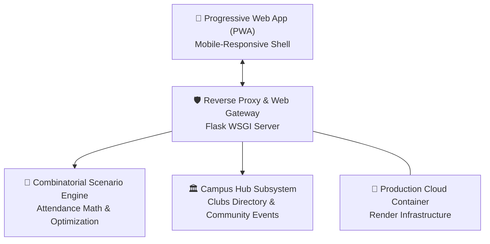

# TEIN (Bunku-Bhaiya) — Smart Attendance Intelligence & Campus Hub Platform

 

  <b>A comprehensive university campus intelligence platform combining real-time attendance forecasting, combinatorial what-if scenario planning, and an integrated student club discovery ecosystem.</b>

[**🚀 Launch Live Web App (tein.onrender.com)**](https://tein.onrender.com)

---

## 📌 Executive Overview

In academic environments where a mandatory **75% minimum attendance rule** governs semester exam eligibility, students often struggle to accurately calculate attendance buffers, project the recovery cost of missed lectures, or track day-to-day impact.

**TEIN** (*Bunku-Bhaiya*) is a purpose-built university student companion engineered to eliminate academic guesswork. It provides:
1. **Mathematical Attendance Optimization**: Instant calculation of exact safe lecture skips (*buffer*) and mandatory recovery lectures (*deficit recovery*).
2. **Combinatorial What-If Simulator**: Forward-looking projection model calculating how hypothetical skips or attendance streaks affect overall percentages across custom date ranges.
3. **Today's Journey**: Subject-level daily lecture breakdown tracking real-time status as the academic day progresses.
4. **Campus Discovery Hub**: Centralized directory and event tracking ecosystem profiling **20+ university clubs** across robotics, software engineering, arts, and athletics.

---

## ⚡ Core Engineering Pillars

### 1. Attendance Forecasting & What-If Engine
Traditional attendance portals only show raw historical percentages without actionable guidance. TEIN models attendance using predictive mathematics:

$$\text{Can Bunk}(A, H, R) = \max\left(0, \left\lfloor \frac{100 \cdot A}{R} - H \right\rfloor\right)$$

$$\text{Must Attend}(A, H, R) = \max\left(0, \left\lceil \frac{R \cdot H - 100 \cdot A}{100 - R} \right\rceil\right)$$

*Where $A$ is classes attended, $H$ is total classes held, and $R$ is the required institutional threshold (e.g., 75% or 80%).*

- **Instant Zone Classification**: Classifies student status dynamically into *Solid*, *Safe*, *Risky*, or *Detained*.
- **Multi-Subject Granularity**: Evaluates individual theory subjects, practical labs, and cumulative totals independently.

---

### 2. Campus Clubs & Events Discovery

<table>
<tr>
<td width="50%" align="center">
 
<b>Safe Zone Status</b>
</td>
<td width="50%" align="center">
 
<b>Target Goal Tracking</b>
</td>
</tr>
</table>

Beyond academic planning, TEIN integrates a rich campus life ecosystem:
- **Club Directory**: Detailed profiles, domains, lead rosters, and joining channels for 20+ active campus clubs (Aerobots, CodeChef, CSI, Cypher, Technocrafts, etc.).
- **Live Event Banners**: Media-rich showcase highlighting upcoming hackathons, orientations, sports tournaments, and workshops.
- **Student Submissions**: Peer-driven event intake pipeline allowing societies to broadcast announcements directly to students.

---

### 3. Mobile-First Progressive Web App (PWA)
- **Installable Native Experience**: Add to Home Screen support on iOS Safari, Android Chrome, and Windows Desktop.
- **Offline Shell Caching**: Built with `/sw.js` service worker caching critical styling and templates for low-connectivity campus environments.
- **Responsive Viewport Architecture**: Fine-tuned CSS layouts optimized for single-handed mobile navigation.

---

## 🛠️ Technology Architecture

| Layer | Technologies & Design Decisions |
| :--- | :--- |
| **Frontend & UI** | Progressive Web App (PWA), Service Worker offline cache, CSS Grid/Flexbox, Native Mobile Inputs |
| **Backend Framework** | Python 3.14, Flask, Jinja2 Templating Engine, Session Management |
| **Runtime & WSGI** | Gunicorn Multithreaded Application Server |
| **Containerization** | Docker Linux Jammy containerized deployment |
| **Cloud Hosting** | Hosted on Render Cloud Infrastructure with zero-downtime healthchecks |
| **Testing** | 25 Automated Unit Test Suites (`AttendanceStateTests`, `ScenarioEngineTests`) |

---

## 🔒 Enterprise & Privacy Architecture Notice

To ensure institutional integrity, student privacy, and compliance with institutional data governance:
- **Core Institutional Bridges**: The underlying enterprise synchronization pipelines, internal university data models, and credential management infrastructure are maintained in a **secure, private production enclave**.
- This public repository serves as the official **Public Architecture, Product Documentation, and Feature Specification Showcase**.
- Students and university members can access the fully operational service directly via the production web application.

---

## 🚀 Live Access & Verification

The production application is continuously deployed and operational:

👉 **[Launch TEIN Live Application](https://tein.onrender.com)**

---

## 📄 License & Attribution

Architected & built by **[Utkarsh Sharma](https://github.com/shutkarshX)**.  
Distributed under the [MIT License](LICENSE).
