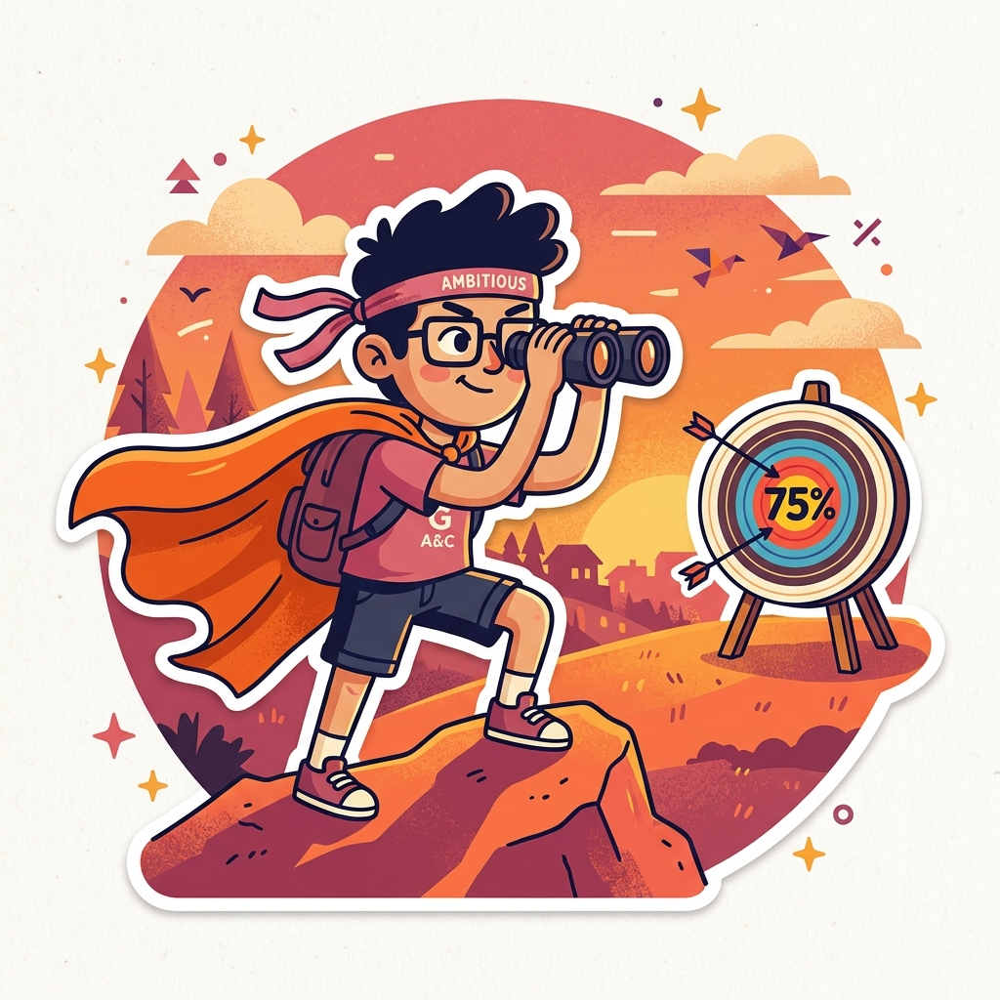

# TEIN — Smart Attendance & Campus Hub 🎓

  

 

### The all-in-one attendance companion and campus clubs platform for university students.

[**👉 Open Live App (tein.onrender.com)**](https://tein.onrender.com)

---

### ✨ What TEIN Does

Traditional college portals only dump raw attendance percentages without telling you what to do next. TEIN turns raw numbers into clear, actionable advice:

- 🟢 **Safe Bunk Calculator** — Know exactly how many classes you can afford to miss while staying safely above the mandatory 75% limit.
- 🔴 **Recovery Plan** — Slumped into the danger zone? Get the exact number of consecutive classes you must attend to recover.
- 🔮 **What-If Simulator** — Test hypothetical skips or attendance streaks across upcoming dates before taking time off.
- 🕒 **Today's Journey** — Track lectures day-by-day with real-time updates as each class finishes.
- 📱 **Installable PWA** — Add directly to your phone's home screen (iOS & Android) with offline caching for slow campus Wi-Fi.

---

### 🏛️ Campus Clubs & Events Hub

<table>
<tr>
<td width="50%" align="center">
 
<b>Safe Zone Guidance</b>
</td>
<td width="50%" align="center">
 
<b>Target Goal Tracking</b>
</td>
</tr>
</table>

Beyond attendance, TEIN connects students with campus life:
- **20+ Student Clubs** — Profiles, domains, and joining channels for technical societies, robotics, arts, and sports.
- **Event Feed** — Live updates on upcoming hackathons, orientations, workshops, and tournaments.
- **Student Submissions** — A platform for club leads to broadcast official event announcements directly to students.

---

### 🛠️ Built With

- **Backend**: Python 3 · Flask · Gunicorn
- **Frontend**: Mobile-first Responsive UI · Progressive Web App (PWA)
- **Deployment**: Docker · Render Cloud

---

> **Note:** University portal synchronization and authentication logic are maintained in a private repository to safeguard student credentials and internal endpoints. This repository serves as the public product showcase.

---

Built by **[Utkarsh Sharma](https://github.com/shutkarshX)** · [MIT License](LICENSE)
